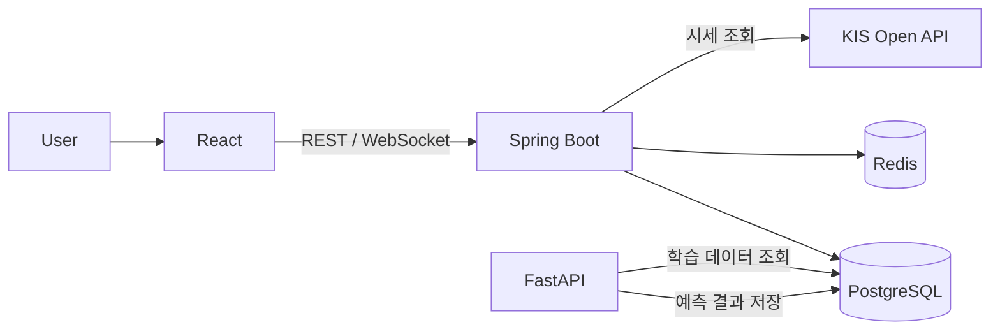

# TickerLab

> 리스크 없이 투자 전략과 AI 예측을 실험하는 모의주식 투자 플랫폼

**TickerLab**은 종목을 뜻하는 *Ticker*와 실험실 *Lab*을 합친 이름으로, 실시간 시세 기반 모의투자와 AI 주가 방향 예측 기능을 제공합니다.

<br>

## Tech Stack

### Backend


### Frontend


### AI


### Data & Infra


<br>

### 상세 구성

| 영역 | 구분 | 기술 |
|---|---|---|
| **Backend** | Language / Framework | Java 17, Spring Boot 3 |
| | ORM | Spring Data JPA |
| | 인증 | Spring Security + JWT |
| | 실시간 통신 | WebSocket (STOMP) |
| | 스케줄링 | Spring Scheduler |
| | 테스트 | JUnit 5, Mockito |
| | API 문서 | Swagger (springdoc-openapi) |
| **Frontend** | Framework | React + TypeScript |
| | Build | Vite |
| | 상태 관리 | TanStack Query (서버 상태), Zustand (클라이언트 상태) |
| | 차트 | Lightweight Charts |
| | 스타일 | Tailwind CSS |
| **AI** | Language / Framework | Python 3.11, FastAPI |
| | 데이터 처리 | pandas, numpy |
| | 모델 | XGBoost, scikit-learn |
| **Data** | Database | PostgreSQL |
| | Cache | Redis |
| | 시세 데이터 | 한국투자증권 KIS Open API (실시간), yfinance (과거 데이터 수집) |
| **Infra** | Container | Docker, Docker Compose |
| | CI/CD | GitHub Actions |
| | 배포 | AWS EC2 |

<br>

## Architecture



- **Spring Boot**: 회원, 계좌, 주문, 체결, 시세 등 핵심 도메인 담당
- **FastAPI**: 예측 모델 학습·추론 전담. 장 마감 후 배치로 예측값을 계산해 DB에 저장
- AI 서버에 장애가 발생해도 주문·체결 기능은 정상 동작하도록 서비스 간 결합도를 최소화

<br>

## Project Structure

```
tickerlab/
├── backend/            # Spring Boot
├── frontend/           # React
├── ai/                 # FastAPI + 모델 코드
│   ├── app/            # API 서버
│   ├── training/       # 학습 스크립트
│   └── notebooks/      # 실험용 노트북
├── docs/               # 아키텍처, API 명세, 회고
├── docker-compose.yml
└── README.md
```

<br>

## Commit Convention

[Conventional Commits](https://www.conventionalcommits.org/) 규칙을 따릅니다.

### 형식

```
<type>(<scope>): <subject>

<body>        # 선택
```

### Type

| Type | 설명 |
|---|---|
| `feat` | 새로운 기능 추가 |
| `fix` | 버그 수정 |
| `refactor` | 기능 변화 없는 코드 구조 개선 |
| `test` | 테스트 코드 추가·수정 |
| `docs` | 문서 수정 (README, 주석 등) |
| `style` | 코드 포맷팅, 세미콜론 등 동작에 영향 없는 변경 |
| `chore` | 빌드 설정, 패키지 관리, 기타 잡무 |
| `ci` | CI/CD 설정 변경 |
| `perf` | 성능 개선 |

### Scope

| Scope | 대상 |
|---|---|
| `frontend` | `frontend/` 디렉토리 변경 |
| `backend` | `backend/` 디렉토리 변경 |
| `ai` | `ai/` 디렉토리 변경 |

> 여러 영역에 걸친 변경이나 루트 파일(`docker-compose.yml`, `README.md` 등) 변경은 scope를 생략합니다.

### 규칙

- subject는 50자 이내, 마침표 없이 작성
- subject는 명령형 현재 시제로 작성 (예: "추가", "수정")
- 하나의 커밋에는 하나의 논리적 변경만 포함
- body에는 **무엇을, 왜** 변경했는지 작성

### 예시

```
feat(backend): 매수 주문 API 구현
fix(backend): 동시 주문 시 잔고 차감 오류 수정
feat(frontend): 종목 상세 캔들차트 추가
refactor(frontend): 주문 폼 상태 관리를 Zustand로 이전
feat(ai): XGBoost 기반 등락 예측 모델 추가
chore(ai): 학습 데이터 수집 스크립트 추가
ci: 폴더별 GitHub Actions 워크플로우 분리
docs: README 아키텍처 다이어그램 추가
```

<br>

## Roadmap

- [ ] 회원 / 계좌 / 인증
- [ ] 주문·체결·잔고 (트랜잭션, 동시성 제어)
- [ ] 시세 연동 및 일봉 데이터 적재
- [ ] 차트 / 포트폴리오 대시보드
- [ ] FastAPI 예측 파이프라인 연결
- [ ] 예측 모델 적용 및 검증
- [ ] Docker Compose, CI/CD, 배포

<br>

## License

This project is licensed under the [MIT License](LICENSE).

> 시세 데이터는 각 제공처(한국투자증권 KIS Open API, Yahoo Finance)의 이용약관을 따르며, 본 레포지토리에는 데이터 파일을 포함하지 않고 수집 스크립트만 제공합니다.
